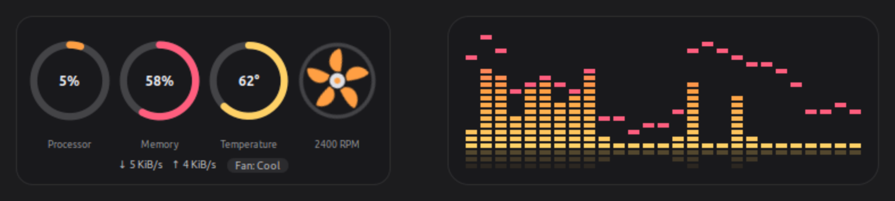
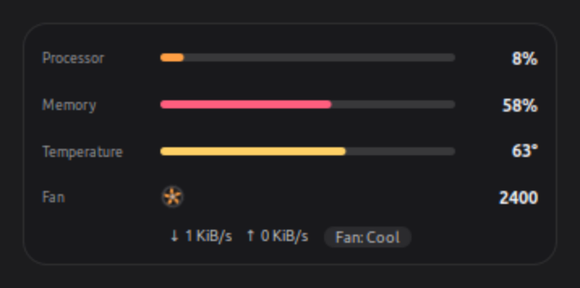
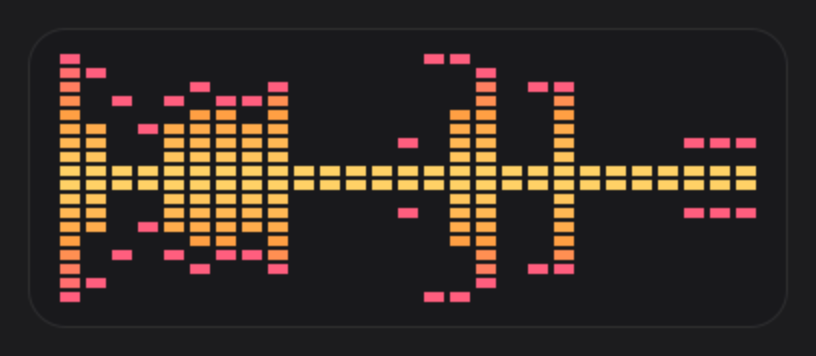
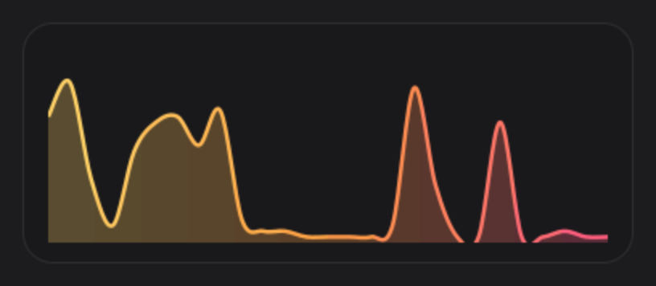
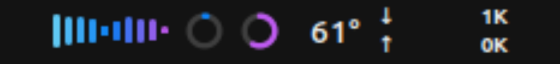
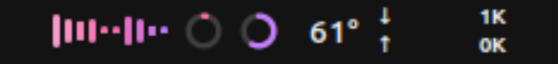

<p align="center">
  
</p>

<h1 align="center">Tempo</h1>

<p align="center">
  <b>A super light system monitor for the GNOME top bar.</b><br>
  CPU and memory rings, temperature, internet speed and fans at a glance on Linux,<br>
  with a music visualizer and desktop widgets when you want them. Every part has its own switch.
</p>

<p align="center">
  <a href="https://github.com/saikatnjm/tempo/actions/workflows/ci.yml"></a>
  
  
</p>

<p align="center">
  
</p>

**Website:** <https://saikatnjm.github.io/tempo/>

Tempo is one small GNOME Shell extension that does six things people usually install separately,
and costs next to nothing to run (the readings add no measurable processor load; every figure
is [measured](#light-by-design)):

- a [lightweight system monitor](https://saikatnjm.github.io/tempo/system-monitor.html) for the top bar: CPU and memory rings, with the details one click away
- [CPU temperature](https://saikatnjm.github.io/tempo/cpu-temperature.html) in the top bar, amber and red when it gets hot
- an [internet speed meter](https://saikatnjm.github.io/tempo/network-speed.html): download and upload speed in a width that never changes
- a [music visualizer for Linux](https://saikatnjm.github.io/tempo/music-visualizer.html): bars in the top bar or floating on the desktop
- [desktop widgets for GNOME](https://saikatnjm.github.io/tempo/desktop-widgets.html): a floating system panel and visualizer
- [fan speeds, and optional fan control](https://saikatnjm.github.io/tempo/fan-control.html) for computers that start their fans too late

It works on Ubuntu, Fedora, Debian, Arch and every other distribution with GNOME 42 to 50.

## What you get

### In the top bar

| | |
|---|---|
| **Two rings** | One fills up with processor use, the other with memory use. No numbers to read; a glance is enough. |
| **Temperature** | The processor's temperature, turning amber above 75 °C and red above 85 °C. Celsius or Fahrenheit. |
| **Network speed** | Download over upload in two small lines of fixed width, so the top bar never shuffles sideways as the numbers change. Off by default. |
| **Music visuals** | While a media player is playing, Tempo moves with the sound, and stops when it stops. You choose how: ten **small bars** next to the rings, or a **level line** along the bottom of the whole top bar that grows out from the middle with the loudness. Off by default. |
| **Now playing** | Rest the pointer on the bars to see what is playing and in which app. The menu shows it too, and a click takes you to that app. |
| **One menu** | Click for processor speed and load, memory and swap, graphics and disk temperature, every fan, network speed, and the four busiest apps. |

<p align="center">
  
</p>

<p align="center">
  <br>
  <sub>Rest the pointer on the bars to see what is playing, and in which app.</sub>
</p>

<p align="center">
  <br>
  <sub>The level line, three times life size: it grows out from the middle as the music gets louder.</sub>
</p>

### On the desktop: floating panels

Two optional panels that you place anywhere, on any screen. Each one replaces its part of the
top bar while it is on, so nothing is shown twice. Both are off by default.

| | |
|---|---|
| **System panel** | Processor, memory, temperature and network speed in one place, as **rings** or as **bars**. A little fan turns while your computer's real fan does, faster as it speeds up, with the speed next to it. |
| **Visualizer panel** | The music, bigger. **Bars** of lit segments in your palette's colours, with peak caps that fall back and a faint reflection; the same bars **mirrored** around the middle; or a smooth **wave**. A wider panel shows more bars, a taller one more segments. |
| **Move and zoom** | Drag a panel to move it. Drag its bottom-right corner to zoom it: it keeps its shape, and the rings, text and bars grow with it. Drag the right or bottom edge to change its shape. Its place and size are remembered. |
| **Your choice of look** | On the desktop behind your windows (like a widget) or on top of them; with a glass, solid or clear background; in any of the four palettes. |

<p align="center">
  <br>
  <sub>The system panel (as rings) and the visualizer panel (as bars).</sub>
</p>

| System panel as bars | Visualizer mirrored | Visualizer as a wave |
|---|---|---|
|  |  |  |

### Everywhere

| | |
|---|---|
| **Four palettes** | Ember, Aurora, Orchid, or Mono (plain, in the top bar's own text colour). |
| **A switch for everything** | Each part can be turned on or off on its own. A part that is off costs nothing. |
| **Optional fan control** | For computers that start their fans late: one button in the settings installs a tiny service, and the menu gets a Fan mode switch. See [below](#optional-fan-control). |

The four palettes:

| Ember (default) | Aurora |
|---|---|
|  |  |
| **Orchid** | **Mono** |
|  |  |

The pictures on this page are screenshots, not drawings. The project's test tool takes them from
a GNOME Shell running the current code, with generated music playing. The song and the app
names in them are test data.

## Light by design

Tempo was built for a laptop that runs hot, so the rule is simple: do nothing unless something
on screen needs to change.

All figures are percent of **one** processor core, measured on a 2019 laptop (Ryzen 5 3500U,
eight threads, GNOME Shell 42). One percent of one core is about 0.125 % of the whole processor.

### In a clean room

`make bench` runs a hidden GNOME Shell with nothing else in it and generated music playing the
way a browser plays it (the sound arrives in about 200 small pieces a second, as on a real
desktop), and reports how much processor time that shell uses in each state. This is Tempo's
own cost, and anyone can repeat it:

<!-- BENCH:START -->
| State | Added cost |
|---|---|
| Rings, temperature and network shown | Nothing measurable |
| Level line at 8 updates a second (the default rate) | 1.4 % |
| Level line at 12 updates a second | 2.1 % |
| Small bars at 8 updates a second | 2.1 % |
| Small bars at 12 updates a second | 2.6 % |
| Small bars at 20 updates a second | 4.2 % |
| Floating system panel | 0.2 % |
| Its little fan, while the real fan turns | 0.7 % more |
| Floating visualizer panel at 8 updates a second | 2.7 % |
<!-- BENCH:END -->

The rings, the temperature and the network speed are free: one timer every 3 seconds reads three
small `/proc` files and one sensor, and nothing is redrawn unless a value changed.

Moving with music is the one thing that costs. Of the 2.6 % for the small bars at 12
updates a second, listening and the maths are 1.0 %; the rest is GNOME Shell repainting
the screen for every update. That is why the update rate is a setting with a modest default of
8, and why the little fan turns in five steps a second and no more.

Version 1.1 woke the desktop shell for every small piece of sound. Measured the same way, its
small bars at 8 updates a second cost 10.7 % and its level line 10.2 %.

### On a real desktop

A real desktop also has real screens to repaint and other things running, so the music figures
are somewhat higher there. `tools/measure.sh` measures your own desktop while you play something.
What does not change:

<!-- REAL:START -->
| State | Cost |
|---|---|
| Rings, temperature and network shown | Nothing measurable |
| Music on, nothing playing | Nothing runs |
| Music on, a fullscreen window in front of the visuals | Nothing runs |
| The screens are off | Nothing runs |
| The recorder (`parec`, 16 kHz mono), while music is shown | 1.0 %, and 6 MB of memory |
<!-- REAL:END -->

One thing Tempo cannot know is whether a window covers a floating panel on the desktop: a
panel behind a window still animates. Switch the visualizer panel off when you don't want it.

On disk, the installed extension is about 250 KB. There is no compiled code, and no background
service unless you add the optional fan control.

### How it stays light

- **Nothing is polled for music.** Tempo listens for the standard media-player announcements
  on the session bus. The recorder starts when a player says "Playing" and stops a few seconds
  after it pauses, so your sound card can go back to sleep.
- **One look at the sound per frame.** Sound servers deliver sound in 100 to 200 small pieces
  a second. Tempo lets them wait in a pipe and reads them all at once, once per frame, so the
  desktop shell wakes 8 times a second for music, not 200.
- **Drawn once, then only stretched.** The small bars, the level line and the visualizer's
  bars are each drawn a single time. After that the graphics card stretches or uncovers them;
  nothing is redrawn while the music plays.
- **Redraw only on change.** A ring is repainted only when its percentage changes; a label
  only when its text changes; a bar is only touched when its height changes.
- **Asleep when you can't see it.** While the screens are off, Tempo reads nothing, listens to
  nothing and animates nothing. While a fullscreen window covers the music visuals, the
  recorder is stopped.
- **Slow sensors never block your desktop.** Hardware sensors are read on a worker thread.
  The process list is read in small slices between frames.
- **Menu details are read only while the menu is open**, and the players are asked what they
  are playing only while the pointer rests on the bars.
- **A part that is switched off does not run.** With every part off, Tempo removes its timer.

## Works on

Tempo is a GNOME Shell extension, so it runs on any distribution that uses the GNOME desktop,
on any processor architecture. It does not run on KDE Plasma, Xfce, Cinnamon or COSMIC.

<!-- COMPAT:START -->
| GNOME Shell | You have it on | Status |
|---|---|---|
| 42 | Ubuntu 22.04 LTS, Pop!_OS 22.04 | Tested on a real desktop and on every change |
| 43 | Debian 12 | Tested on every change |
| 44 | Fedora 38 | Same build as 42 and 43 |
| 45 | Fedora 39, Ubuntu 23.10 | Same build as 46 |
| 46 | Ubuntu 24.04 LTS | Tested on every change |
| 47 | RHEL 10, AlmaLinux 10, Rocky Linux 10, Fedora 41 | Same build as 46 and 48 |
| 48 | Debian 13, Fedora 42, Ubuntu 25.04 | Tested on every change |
| 49 | Fedora 43, Ubuntu 25.10 | Tested on every change |
| 50 | Ubuntu 26.04 LTS, Fedora 44 | Tested on every change |
<!-- COMPAT:END -->

"Tested on every change" means that each time the code changes, GitHub loads the extension in
that GNOME Shell and exercises every feature: all settings, the menu, all palettes, the music
visuals with real captured sound, the hover card, the floating panels (dragged and zoomed with
the pointer, as you would), pausing while the screens are off, switching the extension off and
on, and the settings window. The CI badge at the top shows the latest result.

Temperature needs a sensor the kernel exposes: AMD (`k10temp`), Intel (`coretemp`) and most ARM
boards work out of the box. Where there is none, the temperature simply isn't shown.

Music visuals need `parec`, which comes with `pulseaudio-utils` and is already installed on
Ubuntu, Fedora, Debian and most other GNOME desktops. It works with both PulseAudio and
PipeWire.

## Optional: fan control

Some computers start their fans late; a Dell Inspiron 3505 waits until about 90 °C. The
optional `tempo-fan` service runs every fan Linux can control from its temperature, and adds
a **Fan mode** switch to Tempo's menu:

| Mode | What the fans do |
|---|---|
| **Cool** (default) | 30 % speed below 60 °C, rising evenly to full speed at 85 °C. Laptops whose fan only knows off, low and high (Dell) switch to low at 70 °C and stay there until it is back below 58 °C, and to high at 85 °C, so the fan doesn't flicker on and off. |
| **Full speed** | Every fan at full speed. |
| **Automatic** | Hands off: the computer decides, as if the service were not there. |

To install it, open Tempo's **Settings**, scroll to **Fan control** and press **Install**. GNOME
asks for your password once (fans can only be driven with administrator rights). The same button
removes it. From the source code it is `sudo bash fan/install.sh`, and
`sudo bash fan/install.sh remove`.

It is a few lines of bash that start no programs while running and use about 5 MB of memory.
When it stops, every fan goes back to the computer's own control; if it ever crashed, a fan
that has no automatic mode to go back to is set to full speed, never left off. Tempo works
without it, and most computers don't need it. See [fan/README.md](fan/README.md) for what it supports and how
it stays safe.

## Install

### From a release

1. Download the zip that matches your GNOME Shell version (`gnome-shell --version` tells you):
   - **[GNOME 45 and newer](https://github.com/saikatnjm/tempo/releases/latest/download/tempo-gnome45-plus.shell-extension.zip)**
   - **[GNOME 42, 43 and 44](https://github.com/saikatnjm/tempo/releases/latest/download/tempo-gnome42-44.shell-extension.zip)**

   Both links always download the newest version.
2. Install it:

   ```sh
   gnome-extensions install --force ~/Downloads/tempo-gnome45-plus.shell-extension.zip
   ```

3. Log out and back in, then switch it on:

   ```sh
   gnome-extensions enable tempo@saikatnjm.github.io
   ```

The [install guide](https://saikatnjm.github.io/tempo/install.html) has the steps for each
distribution (Ubuntu, Fedora, Debian, Arch, openSUSE and more) and fixes for common problems.

### From source

```sh
git clone https://github.com/saikatnjm/tempo.git
cd tempo
make install
```

Then log out and back in. `make install` picks the right build for your GNOME Shell, needs no
root access, and only needs `glib-compile-schemas` (package `libglib2.0-bin` on Debian and
Ubuntu, `glib2` on Fedora).

### Update

Updating is installing again over the old version; your settings are kept.

1. Download the newest zip with the same two links as above.
2. Run the install command again (`--force` is what replaces the old version).
3. Log out and back in. **Settings → About** shows the version you are running.

From source: `git pull && make install`, then log out and back in.

### All versions

Every version stays available. To go back to one, install its zip exactly like an update.

| Version | Released | What it brought | GNOME 45 and newer | GNOME 42 to 44 |
|---|---|---|---|---|
| **1.2.0** (newest) | 23 Nov 2026 | Floating panels, optional fan control, much lighter listening | [zip](https://github.com/saikatnjm/tempo/releases/download/v1.2.0/tempo-1.2.0-gnome45-plus.shell-extension.zip) | [zip](https://github.com/saikatnjm/tempo/releases/download/v1.2.0/tempo-1.2.0-gnome42-44.shell-extension.zip) |
| 1.1.0 | 22 Nov 2026 | Level line, every fan in the menu, GNOME 50 | [zip](https://github.com/saikatnjm/tempo/releases/download/v1.1.0/tempo-1.1.0-gnome45-plus.shell-extension.zip) | [zip](https://github.com/saikatnjm/tempo/releases/download/v1.1.0/tempo-1.1.0-gnome42-44.shell-extension.zip) |
| 1.0.0 | 19 Nov 2026 | First release (does not run on GNOME 50) | [zip](https://github.com/saikatnjm/tempo/releases/download/v1.0.0/tempo-1.0.0-gnome45%2B.shell-extension.zip) | [zip](https://github.com/saikatnjm/tempo/releases/download/v1.0.0/tempo-1.0.0-gnome42-44.shell-extension.zip) |

What changed in each is in the [changelog](CHANGELOG.md); the
[releases page](https://github.com/saikatnjm/tempo/releases) has every file.

### Remove

1. If you installed the optional fan control, remove it first: **Settings → Fan control →
   Remove** (or `sudo bash fan/install.sh remove`). Every fan goes back to the computer.
2. Remove Tempo:

   ```sh
   gnome-extensions uninstall tempo@saikatnjm.github.io
   ```

3. Optional, to forget its settings too:

   ```sh
   dconf reset -f /org/gnome/shell/extensions/tempo/
   ```

Nothing else was ever installed: Tempo is one folder in your home directory.

## Settings

Open them from Tempo's menu (**Settings**), or from the Extensions app.

| Setting | Default | What it does |
|---|---|---|
| Processor ring | On | Shows the ring that fills with processor use |
| Memory ring | On | Shows the ring that fills with memory use |
| Temperature | On | Shows the processor temperature |
| Network speed | Off | Shows download and upload speed |
| React to music | Off | Shows the music visuals while a media player is playing |
| Show it as | Small bars | Small bars, or the level line along the whole top bar |
| Smoothness | 8 | Music updates per second (5 to 30). Higher is smoother and costs more |
| Colours | Ember | Ember, Aurora, Orchid or Mono |
| Temperature unit | Celsius | Celsius or Fahrenheit |
| Refresh every | 3 | Seconds between system readings (1 to 10) |
| System panel | Off | Shows the floating system panel (and takes the rings, temperature and network speed out of the top bar) |
| System panel design | Rings | Rings or bars |
| Visualizer panel | Off | Shows the floating visualizer panel (and takes the music visuals out of the top bar) |
| Visualizer design | Bars | Bars, mirror or wave |
| Background | Glass | Glass, solid or clear, for both panels |
| Place them | On the desktop | On the desktop behind windows, or on top of windows |
| Fan control service | Not installed | Installs or removes the optional fan service |

The two floating panels also have switches in the menu, under **Floating panels**.

If you switch every part off, a small Tempo icon stays in the top bar so you can still reach
the menu.

## Music and your privacy

- Tempo reads the sound **going to your speakers**. It never opens the microphone.
- The sound is turned into a handful of bar heights in memory and then thrown away. Nothing is
  saved, and Tempo never uses the network.
- The recorder only runs while a media player (a browser tab, VLC, Spotify, Rhythmbox and so
  on) reports that it is playing.
- GNOME shows a "microphone in use" icon for every recording stream, even one that only reads
  the speakers, except for the two level meters it knows by name. To keep that icon truthful,
  Tempo's stream uses the same id as one of them (pavucontrol's). You can check what it reads
  with `pactl list source-outputs`: the stream is called "Tempo" and is attached to your
  speakers' monitor, not to a microphone.

## Questions

**Which app is making that sound?**
Rest the pointer on the small bars, or open the menu: the song and the app are at the top.
Click it there to go to the app.

**Small bars or level line?**
A matter of taste: the bars show the music's shape next to the rings, the line shows its
loudness across the whole top bar. The line is a little lighter on the processor.

**The bars don't show up.**
Check that *React to music* is on, that something is actually playing sound, and that the
player supports the standard media controls (if it shows up in GNOME's media controls in the
notification list, it does). Games and apps without those controls won't trigger the bars.

**The temperature isn't shown.**
Your machine has no sensor Tempo recognises. Please open an issue with the output of
`grep . /sys/class/hwmon/hwmon*/name`.

**A floating panel can't be dragged.**
A panel on the desktop sits behind everything else, so a click only reaches it where nothing is
in front. If your desktop shows icons (Ubuntu's Desktop Icons does), or you use the older X11
session, the click never arrives. In the settings, set *Place them* to *On top of windows*, move
and size the panel, then switch back.

**The little fan in the system panel doesn't turn.**
It turns only while the real fan does. Many laptops keep the fan off until they are warm. If
the panel shows no fan at all, your computer doesn't report a fan speed to Linux.

**Does Tempo keep working when the screen is off or locked?**
No, on purpose. While the screens are off it reads nothing, listens to nothing and animates
nothing; on the lock screen GNOME switches extensions off altogether.

**Can it show numbers next to the rings?**
The numbers are one click away in the menu. Keeping the top bar calm is the point.

**Does it work on KDE, Xfce or Cinnamon?**
No. Those desktops have their own panel systems; Tempo is written for GNOME Shell.

## Development

```sh
make build     # both variants into build/
make test      # unit tests (plain gjs), and the fan service against fake fan hardware
make smoke     # every feature, in a hidden, throwaway GNOME Shell
make bench     # measure the processor cost in that hidden shell
make zip       # installable zips into dist/
```

See [CONTRIBUTING.md](CONTRIBUTING.md) for how the code is organised and the ground rules,
and [CHANGELOG.md](CHANGELOG.md) for what changed.

## Licence

[GPL-3.0-or-later](LICENSE). Tempo is not affiliated with or endorsed by the GNOME Foundation.
