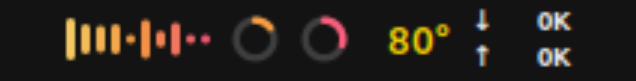
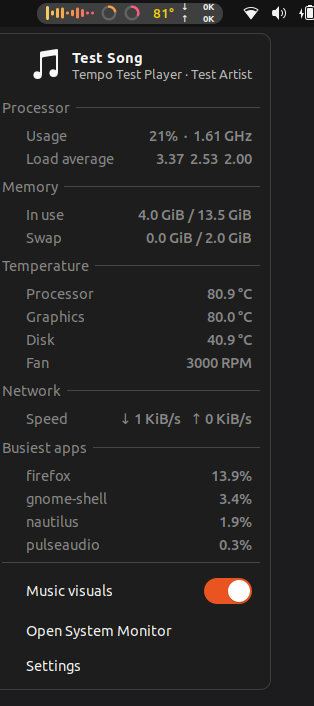
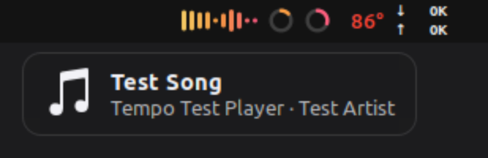
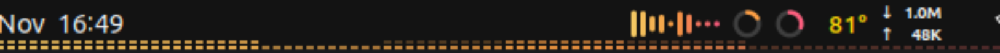
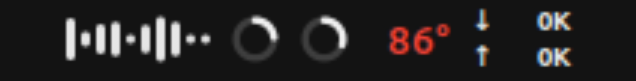

<p align="center">
  
</p>

<h1 align="center">Tempo</h1>

<p align="center">
  <b>Your system and your music, at a glance.</b><br>
  CPU and memory rings, temperature, network speed and music bars for the GNOME top bar.<br>
  Small, quiet, and every part has its own switch.
</p>

<p align="center">
  <a href="https://github.com/saikatnjm/tempo/actions/workflows/ci.yml"></a>
  
  
</p>

<p align="center">
  
</p>

**Website:** <https://saikatnjm.github.io/tempo/>

## What you get

| | |
|---|---|
| **Two rings** | One fills up with processor use, the other with memory use. No numbers to read; a glance is enough. |
| **Temperature** | The processor's temperature, turning amber above 75 °C and red above 85 °C. |
| **Network speed** | Download over upload in two small lines of fixed width, so the top bar never shuffles sideways as the numbers change. Off by default. |
| **Music visuals** | While a media player is playing, Tempo moves with the sound, and stops when it stops. You choose how: ten **small bars** next to the rings, a **light strip** of pixels along the whole top bar, or both. Off by default. |
| **Now playing** | Rest the pointer on the bars to see what is playing and in which app. The menu shows it too, and a click takes you to that app. |
| **One menu** | Click for processor speed and load, memory and swap, graphics, disk and fan readings, network speed, and the four busiest apps. |
| **Four palettes** | Ember, Aurora, Orchid, or Mono (plain, in the top bar's own text colour). |
| **A switch for everything** | Each part can be turned on or off on its own. A part that is off costs nothing. |

<p align="center">
  
</p>

<p align="center">
  <br>
  <sub>Rest the pointer on the bars to see what is playing, and in which app.</sub>
</p>

<p align="center">
  <br>
  <sub>The optional light strip, three times life size: each bar lights its own stretch of the top bar.</sub>
</p>

The four palettes:

| Ember (default) | Aurora |
|---|---|
|  |  |
| **Orchid** | **Mono** |
|  |  |

The pictures on this page are screenshots, not drawings. The project's test tool takes them from
a GNOME Shell running the current code, with generated music playing. The song and the app
names in them are test data.

## Light by design

Tempo was built for a laptop that runs hot, so the rule is simple: do nothing unless something
on screen needs to change.

All figures are percent of **one** processor core, measured on a 2019 laptop (Ryzen 5 3500U,
eight threads, GNOME Shell 42). One percent of one core is about 0.125 % of the whole processor.

### In a clean room

`make bench` runs a hidden GNOME Shell with nothing else in it and generated music playing, and
reports how much processor time that shell uses in each state. This is Tempo's own cost, and
anyone can repeat it:

<!-- BENCH:START -->
| State | Added cost |
|---|---|
| Rings, temperature and network shown | Nothing measurable |
| Small bars at 8 updates a second (the default) | 2.1 % |
| Small bars at 12 updates a second | 3.0 % |
| Small bars at 20 updates a second | 5.4 % |
| Light strip at 12 updates a second | 3.5 % |
| Bars and light strip at 12 updates a second | 4.6 % |
<!-- BENCH:END -->

The rings, the temperature and the network speed are free: one timer every 3 seconds reads three
small `/proc` files and one sensor, and nothing is redrawn unless a value changed.

Moving with music is the one thing that costs, and almost all of it is GNOME Shell repainting a
piece of the top bar for every update. Of the 3.0 % at 12 updates a second, listening and the
maths are 0.9 %; the rest is repainting. That is why the update rate is a setting, why the
default is a modest 8, and why the light strip, which repaints a strip as wide as the screen,
is the most expensive thing Tempo can show.

### On a real desktop

A real desktop drives real screens and runs other things. On the same laptop in daily use (two
1080p screens, a video playing, six other extensions), measured with `tools/measure.sh`:

<!-- REAL:START -->
| State | Cost |
|---|---|
| Rings, temperature and network shown | Nothing measurable |
| Music on, nothing playing | Nothing runs |
| Music on, a fullscreen window hiding the top bar | Nothing runs |
| Small bars at 12 updates a second | About 9 % in GNOME Shell |
| The recorder (`parec`, 16 kHz mono), while music is shown | 1.0 %, and 6 MB of memory |
<!-- REAL:END -->

So expect about three times the clean-room figures on a busy desktop: roughly 6 % of one core
for the small bars at the default rate.

On disk, the installed extension is about 115 KB. There is no compiled code and no background
service.

### How it stays light

- **Nothing is polled for music.** Tempo listens for the standard media-player announcements
  on the session bus. The recorder starts when a player says "Playing" and stops a few seconds
  after it pauses, so your sound card can go back to sleep.
- **Redraw only on change.** A ring is repainted only when its percentage changes; a label
  only when its text changes.
- **Slow sensors never block your desktop.** Hardware sensors are read on a worker thread.
  The process list is read in small slices between frames.
- **Menu details are read only while the menu is open**, and the players are asked what they
  are playing only while the pointer rests on the bars.
- **Nothing is listened to that you can't see.** While a fullscreen window hides the top bar,
  the recorder is stopped.
- **A part that is switched off does not run.** With every part off, Tempo removes its timer.

## Works on

Tempo is a GNOME Shell extension, so it runs on any distribution that uses the GNOME desktop,
on any processor architecture. It does not run on KDE Plasma, Xfce, Cinnamon or COSMIC.

<!-- COMPAT:START -->
| GNOME Shell | You have it on | Status |
|---|---|---|
| 42 | Ubuntu 22.04 LTS, Pop!_OS 22.04 | Tested on a real desktop and by the automated test |
| 43 | Debian 12 | Same build as 42 |
| 44 | Fedora 38 | Same build as 42 |
| 45 | Fedora 39, Ubuntu 23.10 | Same build as 46 |
| 46 | Ubuntu 24.04 LTS | Tested by the automated test |
| 47 | RHEL 10, AlmaLinux 10, Rocky Linux 10, Fedora 41 | Same build as 46 |
| 48 | Debian 13, Fedora 42, Ubuntu 25.04 | Tested by the automated test |
| 49 | Fedora 43, Ubuntu 25.10 | Same build as 48 |
| 50 | Ubuntu 26.04 LTS, Fedora 44 | Same build as 48 |
<!-- COMPAT:END -->

"Tested by the automated test" means the extension was loaded in that GNOME Shell and every
feature was exercised: all settings, the menu, all palettes, music bars with real captured
sound, switching the extension off and on twice, and the settings window. The same test runs
on every change (see the CI badge above).

Temperature needs a sensor the kernel exposes: AMD (`k10temp`), Intel (`coretemp`) and most ARM
boards work out of the box. Where there is none, the temperature simply isn't shown.

Music visuals need `parec`, which comes with `pulseaudio-utils` and is already installed on
Ubuntu, Fedora, Debian and most other GNOME desktops. It works with both PulseAudio and
PipeWire.

## Install

### From a release

1. Download the zip that matches your GNOME Shell version from the
   [releases page](https://github.com/saikatnjm/tempo/releases/latest)
   (`gnome-shell --version` tells you which you have):
   - `tempo-…-gnome45+.shell-extension.zip` for GNOME Shell 45 and later
   - `tempo-…-gnome42-44.shell-extension.zip` for GNOME Shell 42, 43 and 44
2. Install it:

   ```sh
   gnome-extensions install --force tempo-*.shell-extension.zip
   ```

3. Log out and back in, then switch it on:

   ```sh
   gnome-extensions enable tempo@saikatnjm.github.io
   ```

### From source

```sh
git clone https://github.com/saikatnjm/tempo.git
cd tempo
make install
```

Then log out and back in. `make install` picks the right build for your GNOME Shell, needs no
root access, and only needs `glib-compile-schemas` (package `libglib2.0-bin` on Debian and
Ubuntu, `glib2` on Fedora).

### Remove

```sh
gnome-extensions uninstall tempo@saikatnjm.github.io
```

## Settings

Open them from Tempo's menu (**Settings**), or from the Extensions app.

| Setting | Default | What it does |
|---|---|---|
| Processor ring | On | Shows the ring that fills with processor use |
| Memory ring | On | Shows the ring that fills with memory use |
| Temperature | On | Shows the processor temperature |
| Network speed | Off | Shows download and upload speed |
| React to music | Off | Shows the music visuals while a media player is playing |
| Show it as | Small bars | Small bars, a light strip along the whole top bar, or both |
| Smoothness | 8 | Music updates per second (5 to 30). Higher is smoother and costs more |
| Colours | Ember | Ember, Aurora, Orchid or Mono |
| Temperature unit | Celsius | Celsius or Fahrenheit |
| Refresh every | 3 | Seconds between system readings (1 to 10) |

If you switch every part off, a small Tempo icon stays in the top bar so you can still reach
the menu.

## Music and your privacy

- Tempo reads the sound **going to your speakers**. It never opens the microphone.
- The sound is turned into ten bar heights in memory and then thrown away. Nothing is saved,
  and Tempo never uses the network.
- The recorder only runs while a media player (a browser tab, VLC, Spotify, Rhythmbox and so
  on) reports that it is playing.
- GNOME shows a "microphone in use" icon for every recording stream, even one that only reads
  the speakers, except for the two level meters it knows by name. To keep that icon truthful,
  Tempo's stream uses the same id as one of them (pavucontrol's). You can check what it reads
  with `pactl list source-outputs`: the stream is called "Tempo" and is attached to your
  speakers' monitor, not to a microphone.

## Questions

**Which app is making that sound?**
Rest the pointer on the small bars, or open the menu: the song and the app are at the top.
Click it there to go to the app.

**Is the light strip worth it?**
It looks good and it is the most expensive thing Tempo can show, because every update repaints
a strip as wide as your screen. If lightness matters most to you, stay with the small bars.

**The bars don't show up.**
Check that *React to music* is on, that something is actually playing sound, and that the
player supports the standard media controls (if it shows up in GNOME's media controls in the
notification list, it does). Games and apps without those controls won't trigger the bars.

**The temperature isn't shown.**
Your machine has no sensor Tempo recognises. Please open an issue with the output of
`grep . /sys/class/hwmon/hwmon*/name`.

**Can it show numbers next to the rings?**
The numbers are one click away in the menu. Keeping the top bar calm is the point.

**Does it work on KDE, Xfce or Cinnamon?**
No. Those desktops have their own panel systems; Tempo is written for GNOME Shell.

## Development

```sh
make build     # both variants into build/
make test      # unit tests (plain gjs)
make smoke     # full run in a hidden, throwaway GNOME Shell
make bench     # measure the processor cost in that hidden shell
make zip       # installable zips into dist/
```

See [CONTRIBUTING.md](CONTRIBUTING.md) for how the code is organised and the ground rules,
and [CHANGELOG.md](CHANGELOG.md) for what changed.

## Licence

[GPL-3.0-or-later](LICENSE). Tempo is not affiliated with or endorsed by the GNOME Foundation.
